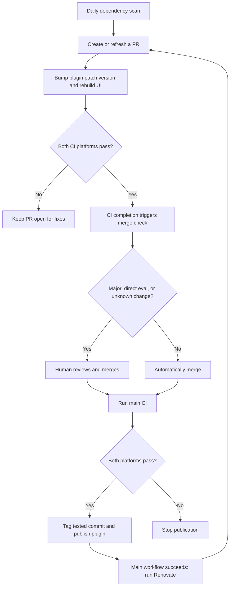

# Dependency updates

Renovate runs daily at 07:17 UTC. Lockfile maintenance runs on Fridays.
This is 08:17 in Paris in winter and 09:17 in summer.
Renovate allows up to five open PRs. Its default limit of two new PRs per hour still applies.
It prepares a versioned PR, then waits for CI.
After each merge, a successful Repository Baseline run on `main` starts a full
Renovate refresh. This rebases remaining PRs, recalculates their plugin versions,
and rebuilds the UI. The refresh also runs while automatic merging is disabled.
When Repository Baseline succeeds for a Renovate PR in this repository, it
triggers the merge check immediately. This check does not scan dependencies.
Failed CI, fork PRs, and disabled automatic merging do not start the merge job.
The merge step checks the actual dependency diff. Labels do not grant permission to merge.



## Merge rules

| Change | Decision |
| --- | --- |
| Non-eval minor, patch, or version/digest pin | Automatic after CI |
| Major update | Manual |
| Direct eval requirement or its locked version/source | Manual |
| Eval tool or container pin | Manual |
| Transitive-only eval update | Automatic after CI, unless major |
| Mixed or unclassified change | Manual |

Direct eval packages come from the root `dependency-groups.eval` list.
The guard checks their entries in both Python lockfiles. This includes shared
packages such as Beancount. It also checks lockfile-only maintenance PRs.
Renovate writes update types into its commit message. The merge step accepts
one App-authored commit, checks its diff, and requires both current CI results.
It merges at most one PR per run. Other PRs must rebase before their next merge.
Successful `main` CI starts the next refresh automatically. Daily and manual
runs provide a fallback if that refresh does not run.
The PR completion trigger uses the helper from `main` and rechecks current PR
heads and CI results. That merge-only run does not execute code or download
artifacts from the PR. The main completion trigger runs the full preparation flow.

The preparation helper uses the base plugin version plus one patch increment.
It updates all local release versions without re-resolving dependencies.
It then builds the UI. Repeated runs against the same base produce the same files.
Human-authored PRs can still choose a higher minor or major release version.

## First setup

1. Register a private GitHub App named `Auto Bean Renovate` under the repository
   owner's account. Use the repository URL as its homepage. Disable webhooks.
2. Give the App these repository permissions: Contents, Pull requests, Issues,
   and Workflows read/write; Checks and Commit statuses read. Metadata read is implicit.
3. Install the App on **only** `SamArgt/auto-bean`. Generate a private key.
4. Store the App ID in the Actions variable `RENOVATE_APP_ID`.
   Store the key in the Actions secret `RENOVATE_APP_PRIVATE_KEY`.
   Do not put the key in a file in this repository or in a chat.
5. Leave `RENOVATE_AUTOMERGE` unset or set it to `false`.
6. Merge the implementation, then manually run the **Renovate** workflow.
   Inspect one generated PR. Confirm its version bump, rebuilt UI, and both
   baseline checks. Also confirm that an eval PR stays manual.
7. Replace the locked `main` protection with these two active branch rulesets:
   - **Main checks**: require PRs, block deletion and force pushes, require
     up-to-date branches, and require `quality-baseline (ubuntu-latest)` and
     `quality-baseline (macos-latest)` from GitHub Actions. No App bypass.
   - **Main reviews**: require one approval and code-owner review. Give only
     the dedicated App the **For pull requests only** bypass.
   Keep ordinary human PRs subject to review. Remove the old branch lock only
   after the replacement rules are active. GitHub's native auto-merge can stay off.
8. Set `RENOVATE_AUTOMERGE=true`. The next successful Renovate PR CI run or
   manual Renovate run can merge an eligible PR.
   Verify that the merge starts main CI and that publication follows its success.

The workflow skips runs until the App ID is configured. An App token ensures
that bot writes and merges start CI. The App cannot bypass the required checks.
CI reports lockfile, version, and generated UI failures. Renovate reports its
preparation errors in its log; it does not need permission to write commit statuses.

## Validation and recovery

```sh
npx --yes --package renovate@44.237.3 -- renovate-config-validator --strict renovate.json
uv run pytest tests/test_renovate.py tests/test_release_workflows.py
```

If preparation fails, inspect the Renovate workflow log and fix the cause.
Request a rebase from the Dependency Dashboard to rebuild the PR.
If CI fails, keep the PR open and fix the failure before merging.
To stop automatic merges, set `RENOVATE_AUTOMERGE=false`.
To stop all Renovate runs, disable the workflow in GitHub Actions.
Live Harbor evaluations remain manual.
