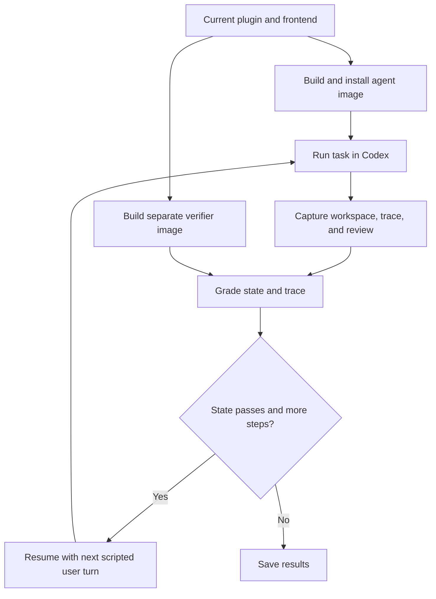

# Harbor workflow evaluations

This suite tests the installed Auto Bean plugin in Docker with synthetic ledgers and original CSV/PDF statements. It builds from the current checkout, including uncommitted changes. It tests conversation workflows and MCP registration, not desktop rendering or panel clicks.

## Run

From the repository root, with Docker, Compose, and uv available:

```sh
uv sync --group dev --group eval
export PYTHONPATH="$PWD"
export CODEX_FORCE_AUTH_JSON=1
uv run --group eval harbor run --config evals/harbor/codex.yaml \
  --n-concurrent 1 --jobs-dir "$PWD/.cache/harbor/jobs"
```

- [codex.yaml](codex.yaml) selects all four tasks, one attempt, `gpt-6.1-sol`, and Codex CLI `0.163.0`.
- Each task requests 2 CPUs, 8 GiB of memory, and 20 GiB of storage. The command overrides the configured concurrency of four to fit an 8 GiB Docker VM.
- Initial builds download runtime dependencies and PDF models. Later builds reuse cached layers.
- `CODEX_FORCE_AUTH_JSON=1` uses the existing `~/.codex/auth.json` sign-in. Keep it in the host environment, not `agents[].env`, to avoid Harbor's artifact-redaction bug.
- Use an absolute jobs directory. Add `-p evals/harbor/tasks/init-ledger` to run only that task.

Run model evaluations and controls only when explicitly requested.

## What it evaluates

| Task and detailed docs | Steps | Main grader checks |
| --- | --- | --- |
| [Initialize a ledger](tasks/init-ledger/README.md) | Init | Valid empty EUR ledger, required workspace files, one clean local commit |
| [Import two statements](tasks/import-two-statements/README.md) | Review → approve | Original CSV/PDF extraction, four transactions from five source rows, one shared transfer, exact balances after approved writes |
| [Resolve missing input](tasks/human-input-correction/README.md) | Needs input → correct → approve | Persist unresolved questions, apply answers without writing, then complete the separately approved import |
| [Reject stale approval](tasks/stale-review/README.md) | Review → stale | Detect a changed decision, preserve it, request renewed approval, and block ledger writes |

The [state grader](verify.py) runs in a separate image with independent expected data. It checks schemas, source evidence, postings, balances, approval boundaries, memory, and protected files. Grader code and expected answers stay outside the agent image. A host-held checkpoint preserves the review that approval covers.

### Agent trace checks

The [trace grader](trace.py) checks native Codex evidence for current ledger/review inspection, required launcher commands, and distinct processing and categorization workers. Narration alone does not count. Missing required evidence blocks full reward; skill/reference reads are diagnostic. See each task's trace section and the [trace tests](tests/test_trace.py) for the detailed rules.

Each step earns full reward only when state and required trace checks pass. Multi-step tasks advance on `state = 1` and average graded step rewards. Inspect all step results: setup errors can leave later steps ungraded.

## Workflow



## Inspect results

Jobs are saved under `.cache/harbor/jobs/<job>/`. Check `result.json` for completion and nested step errors, then inspect each verifier's files:

- `reward.json`: combined, state, and trace scores.
- `report.md` / `report.json`: findings and supporting evidence.
- `trace-report.json`: matched events and missing execution evidence.
- `review.html`: read-only review snapshot; host copies are also in `review-exports/` for import phases.

Captured `artifacts/opt/eval-evidence/build.json` records plugin, runtime, and frontend identities. Use these hashes when comparing runs. [BASELINE.md](BASELINE.md) contains historical results.

## Develop

| Source | Purpose |
| --- | --- |
| [tasks/](tasks/) | Instructions, limits, step setup, verifier entry points, and oracle solutions |
| [adapter.py](adapter.py) | Plugin installation, session resumption, and immutable review checkpoints |
| [fixtures.py](fixtures.py), [environment/](environment/) | Synthetic inputs and agent/verifier image builds |
| [probe_plugin.py](probe_plugin.py), [capture.py](capture.py) | Plugin discovery checks and captured evidence |
| [verify.py](verify.py), [trace.py](trace.py) | State and execution grading |
| [tests/](tests/) | Local harness, grader, and trace regression tests |

Local checks do not start a model evaluation:

```sh
uv run --group eval ruff check
uv run --group eval ruff format --check
uv run --group eval mypy
uv run --group eval pytest tests evals/harbor/tests
uv run --group eval python scripts/package_plugin.py --check
```

After frontend changes, rebuild the bundled UI before running Harbor. See the [repository development commands](../../README.md#setup-and-checks). Image builds reject stale UI assets.

### Harness controls

When explicitly requested, run the scripted oracle and no-op agents:

```sh
uv run --group eval harbor run -p evals/harbor/tasks -a oracle -n 1 \
  --verifier-env AUTO_BEAN_TRACE_POLICY=state-only --jobs-dir "$PWD/.cache/harbor/jobs"
uv run --group eval harbor run -p evals/harbor/tasks -a nop -n 1 \
  --verifier-env AUTO_BEAN_TRACE_POLICY=state-only --jobs-dir "$PWD/.cache/harbor/jobs"
```

Expect oracle rewards of `1` and no-op rewards of `0`. These controls test state grading without model traces; they do not establish a plugin-use pass.
