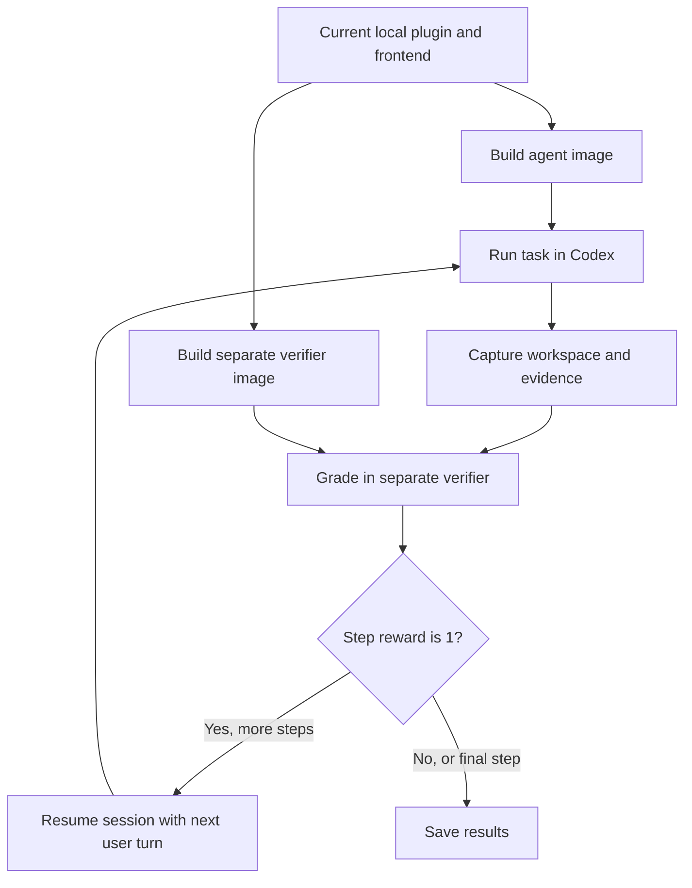
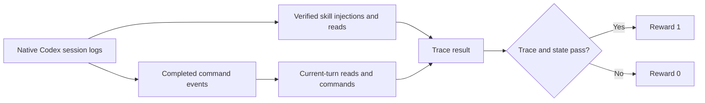

# Harbor workflow evaluations

These four tasks test the installed Auto Bean plugin with synthetic data.
Each task README explains its setup, fixture, steps, and grader.

The import and stale-review tasks request one explicit multi-statement group.
The human-input task lets the agent infer groups. Session validation checks
that groups cover every statement exactly once. Review checkpoints preserve
group membership across approval. Native trace checks require distinct descendant
agents for each active group/stage, with a stage-skill read and evidence access
for its members. Main-agent reads and prose claims do not satisfy delegation.
These checks show observed delegation and access, not a system-call audit.

| Task | What it tests | Steps | Successful end state |
| --- | --- | --- | --- |
| [Initialize a ledger](tasks/init-ledger/README.md) | Create the default EUR workspace | Init | Valid empty ledger; one clean commit |
| [Import two statements](tasks/import-two-statements/README.md) | Review, then approve a CSV and PDF import | Review → approve | Four new transactions; both imports complete |
| [Resolve missing input](tasks/human-input-correction/README.md) | Keep answers separate from approval | Needs input → correct → approve | Corrected decisions; approved import complete |
| [Reject stale approval](tasks/stale-review/README.md) | Detect a decision changed after review | Review → stale | Renewed review; no financial writes |



## Run

Run commands from the repository root.

- Install Docker with Compose and uv.
- Each task requests 2 CPUs, 8 GiB of memory, and 20 GiB of storage.
- The first image build can take several minutes. Unchanged layers are cached.
- Runs are manual. Run Harbor, including oracle and no-op controls, only when explicitly requested.

```sh
uv sync --group dev --group eval
export PYTHONPATH="$PWD"
export CODEX_FORCE_AUTH_JSON=1
uv run --group eval harbor run --config evals/harbor/codex.yaml --jobs-dir "$PWD/.cache/harbor/jobs"
```

[codex.yaml](codex.yaml) selects:

- All four tasks in `evals/harbor/tasks/`.
- Model `gpt-6.1-sol` and Codex CLI `0.163.0`.
- One attempt and one concurrent trial.
- The local `AutoBeanCodex` adapter and native session resumption.

`PYTHONPATH` lets Harbor import the local adapter. The adapter installs the
plugin and retains it across resumed steps. Harbor manages execution and
trajectory capture. No separate prepare or build command is needed.

Use an absolute `--jobs-dir` path. Harbor 0.24 can resolve relative artifact
paths against task directories during Docker Compose runs.

To run one task, set `-p` to its directory. For example:

```sh
uv run --group eval harbor run -c evals/harbor/codex.yaml -p evals/harbor/tasks/init-ledger --jobs-dir "$PWD/.cache/harbor/jobs"
uv run --group eval harbor run -c evals/harbor/codex.yaml -p evals/harbor/tasks/import-two-statements --jobs-dir "$PWD/.cache/harbor/jobs"
```

The other task directory names are `human-input-correction` and `stale-review`.
Use `--model gpt-6-astra` if needed. There is no automatic fallback model.

### Authentication

- `CODEX_FORCE_AUTH_JSON=1` selects the existing `~/.codex/auth.json` sign-in.
- Keep this flag in the host environment. Do not put it in `agents[].env`.
  Harbor 0.24 treats it as a secret there and corrupts artifacts during redaction.
- For API-key authentication, unset the flag and set `OPENAI_API_KEY`.
- Credential values are not stored in the repository.

### Control runs

These commands test the harness without model calls. They still build and run Docker images.

```sh
uv run --group eval harbor run -p evals/harbor/tasks -a oracle -n 1 --verifier-env AUTO_BEAN_TRACE_POLICY=state-only --jobs-dir "$PWD/.cache/harbor/jobs"
uv run --group eval harbor run -p evals/harbor/tasks -a nop -n 1 --verifier-env AUTO_BEAN_TRACE_POLICY=state-only --jobs-dir "$PWD/.cache/harbor/jobs"
```

- Every oracle task should earn `1`.
- Every no-op task should earn `0`.
- A failed intermediate step blocks later steps through its reward gate.
- Check rewards and nested step errors. A zero command exit alone does not prove a pass.

These are **state-only controls**. The scripted oracle has no Codex trace.
The explicit verifier environment setting keeps its state checks runnable.
It does not award a plugin-use pass. Normal runs require both state and trace
checks. Missing traces fail normal runs; there is no automatic oracle exemption.

## Shared setup

Each task's Compose file builds from the repository root with the
[shared Dockerfile](environment/Dockerfile).

| Component | Setup |
| --- | --- |
| Plugin | Copies `plugins/auto-bean/` from the current checkout, including uncommitted edits |
| Frontend | Uses pinned Node and `npm ci`; rebuilds and compares the bundle and build evidence |
| Installation | Installs the complete plugin through a container-local marketplace |
| Runtime | Preloads dependencies and PDF models; smoke-tests CSV and PDF extraction |
| Plugin probe | Checks all nine skills, MCP registration, expected tools, the App resource, and an unbound structured call |
| Init workspace | Leaves `/app/ledger` empty; warms dependencies in a disposable workspace |
| Import workspace | Generates raw statements and an independent, committed ledger fixture |
| Verifier | Uses trusted dependencies, a fixed plugin copy, and independently generated expected data |

The build uses local files. It does not fetch a published plugin or another Git
revision. Changed plugin inputs invalidate the relevant Docker cache layers.
Missing or stale bundled frontend assets cause the build to fail.

The probe does not prove desktop rendering or simulate panel button clicks.
These tasks use conversation turns. MCP and browser integration tests cover
panel controls separately.

## Shared fixture

[fixtures.py](fixtures.py) generates all inputs inside the images.
Regeneration replaces earlier generated fixtures. Runs create no prepared task
copies or fixture snapshots on the host.

The three import tasks share:

- Synthetic owner: Alex Example.
- Period: January 2026. Currency: EUR.
- Checking CSV: a 25 EUR purchase, a 100 EUR transfer out, and a 5 EUR fee.
- Savings PDF: the matching 100 EUR transfer in and 2 EUR interest.
- Opening balances: 1,000 EUR checking and 500 EUR savings.
- Closing balances: 870 EUR checking and 602 EUR savings.
- Five source rows, but four new economic transactions.
- Existing accounts, one opening transaction, and an unrelated user file.

See the [full fixture table](tasks/import-two-statements/README.md#fixture).
The correction task withholds two decisions. The stale-review task changes one
reviewed rationale. The init task starts with no statements in its workspace.

## Grading and approval boundaries

The [grader](verify.py) runs in a separate verifier image.
Grader code and expected answers do not enter agent images. Reference solutions
are uploaded only for oracle runs. Workspace Python is never imported by the grader.

### Before approval

- Agents edit parsed statement decisions and import status directly.
- Parsed documents contain source facts, inline mappings, and transaction postings.
- Sessions contain groups with source membership and one parsed path, plus price runs. Each group has one YAML lifecycle entry and one parsed JSON containing its source sections.
- Canonical financial files must match the initial fixture.
- Review proposals include one document directive per original statement.
  Optional closing assertions must use the exact EUR balance on February 1
  (the beginning of the day after the January 31 closing). The grader parses
  these directives independently and rejects other directive types, targets,
  dates, amounts, duplicate documents, and explicit balance tolerances.
- Reusable learning waits until approved writes pass validation.
- The verifier renders reviewed postings in its own temporary ledger.
  It checks the expected economics independently.

### Approval checkpoint

A checkpoint preserves the review that the user was shown. It holds parsed
documents, material decision hashes, and the canonical financial baseline.

- The adapter reads the native step marker before execution.
- It does not infer approval from session resumption.
- It saves review checkpoints outside the agent workspace and refuses overwrite.
- It restores that saved copy for later verifier artifact transfer.
- Approval comes from the explicit harness turn plus the checkpoint.
- Agent-authored panel approval fields are rejected in these conversation-only tasks.
- There are no separate write proposals, session write targets, or action histories.

### After approval

- Current decisions must match the approved review.
- Written validation must describe the current decisions and canonical ledger.
- Review-stage validation cannot certify completed writes.
- The grader checks entries, Decimal amounts, accounts, source provenance, and balances.
- Written document and balance directives must exactly match the reviewed proposals.
- The EUR-only price stage must record its successful zero-job outcome.
- Eligible account and merchant memory must retain source and validation provenance.
- Global `MEMORY.md` preferences remain unchanged.
- Import tasks preserve raw hashes, existing entries, protected files, and Git history.
- Import tasks may not commit or push. Init requires one local commit.

A changed material decision requires renewed review. The stale-review task
passes only when the changed decision is preserved and financial writes are blocked.

## Inspect results

### Agent trace checks

Every phase also runs [trace.py](trace.py). Full reward requires both the
existing state checks and these trace checks to pass.
Init and import are task version `2.1.0`; correction and stale review are
`3.1.0`. These versions correct supporting-directive, pending-validation,
source-account identity, and CLI trace handling. Earlier rewards do not
establish a pass under these versions.



| Phase | Required loaded skills | Required workflow commands in this turn |
| --- | --- | --- |
| Init | Init | Plugin launcher `init`; `git status` |
| Review | Import, Process, Query, Categorize | Extraction preparation; Docling on each source; ledger query; review validation; `git status` |
| Needs input | Import, Process, Query, Categorize | Extraction preparation; Docling on each source; ledger query; `git status` |
| Correct | Import, Query, Categorize | Ledger query; review validation; `git status` |
| Approve | Import, Write, Query, Prices, Memory | Written validation with a session; `git status` |
| Stale | Import | `git status`; current review file reads |

- A skill counts when a successful content-read command opens its installed
  `SKILL.md`, or a native standalone `<skill>` user message supplies its complete
  body. The injected name, trusted path, and full body must match the verifier's
  plugin bundle. Altered, clipped, assistant-authored, or unrelated-session
  messages do not count. A skill name in a prompt or final answer does not count.
- Common guidance must be read. Import phases also require the import contract
  and parsed, session, and status schemas. Approval adds the memory schema.
- Skill and reference reads can come from earlier turns in the same session.
  Linked descendant workers can supply evidence. Unrelated sessions cannot.
- Each turn must read `ledger.beancount`. Import turns must also read status YAML.
- Read the workspace marker and, for imports, workspace `MEMORY.md` and account
  directives. These context reads can carry over within the session.
- Correct, approve, and stale turns must reread both parsed statement files.
- Approval must read account and category memory before learning.
- Workflow commands must occur after the latest native `task_started` boundary.
  Previous review commands cannot satisfy approval checks.
- Runtime operations must use the plugin launcher or the documented `auto_bean`
  helper. Extraction must target each original source. Validation must name the
  workspace, session, and required stage. A scoped `--price-run` check cannot
  satisfy statement validation.
- The EUR-only price stage needs no fetch command. State checks validate its
  zero-job result and the saved memory. Stale approval needs no write command.

The reader uses native `CommandExecution` terminal events and verified skill
injections from the pinned Codex CLI, including commands that finish after polling. Successful workflow
operations require exit code `0`. It never executes submitted shell code.
Tool-return text, narration, listings, and shell command mentions inside a
here-document cannot supply execution evidence.

Both `subagent.thread_spawn` (CLI 0.163.0) and the older `subagent.spawn`
parent metadata are recognized. The trace report lists descendant identities
separately from their stage/group activity. Unrelated sessions cannot supply
evidence. Missing activity leaves worker distinctness undetermined; it does
not establish that delegation was absent.

The reader supports literal paths, brace and file globs, launcher variables,
simple `&&` chains, and positive-duration `timeout` wrappers. It recognizes the
documented `auto_bean()` helper and equivalent run-only helpers, with or without
an internal timeout. A helper must be invoked and resolve to the trusted launcher.
Definitions alone and arbitrary function bodies do not count.
Git status checks accept literal `-C` directory options when the effective
directory is `/app/ledger`. Options that redirect Git's repository or configuration
do not supply this evidence.

A successful final command after a supported read-only pipeline can count.
The pipeline itself supplies no execution evidence. Literal Python
`Path.read_text()` calls can establish file reads in a successful `python -c`
command or quoted Python here-document, including through the plugin launcher.
The reader inspects only a known unconditional prefix. It stops at unknown
calls, mutations, or control flow and never executes the submitted Python.

For general shell calls, later success cannot prove earlier success across
semicolons or newlines. Two bounded evidence paths recover content reads:

- A sequence containing only plain literal `cat` calls uses complete native
  output and per-operand diagnostics. Failed operands and short-circuited reads
  do not count. Redirects, substitutions, unknown diagnostics, and truncated
  output are excluded.
- A bounded read-only sequence may prove plain `cat` reads through exact full
  file contents in native output. Supported surrounding commands are `pwd`,
  `git status`, `git ls-files`, `ls`, `rg`, and `sort`. Sequences may use `&&`,
  semicolons, newlines, and passive listing pipelines such as `rg --files | sort`.
  The verifier maps paths to its plugin bundle and ledger snapshot. This can
  recover successful reads before a search or directory listing fails. It
  respects explicit failed cat operands and `&&` short-circuiting. Changed,
  absent, hidden, or truncated content does not supply this evidence.

Other pipelines, conditional blocks, and unsupported Python or JavaScript
bodies remain opaque.
Reports identify evidence methods and describe unmatched requirements as
insufficient recognized evidence, rather than claiming the action never ran.

Needs-input checks allow a current failed `review` report for unresolved
decisions. Such a report must contain errors and must not claim checked writes.
Written-stage reports, stale digests, and false readiness claims still fail.
Account lookup uses each source's sole extracted account, not the oracle's local
account ID. The single-account fixture requirement remains enforced.

These checks show observed tool use. They do not prove that the model understood
a skill or provide a tamper-proof system-call audit. Session files are transferred
agent artifacts. Independent state checks remain mandatory.

Each verifier writes:

| Artifact | Purpose |
| --- | --- |
| `reward.txt` | Binary result: `1` for pass, `0` for fail |
| `report.json` | Versioned summary, all executed state assertions and trace checks, source locations, subject context, and failure evidence |
| `report.md` | Rendered Markdown with failures first, status icons, then skipped and passed checks with full evidence |
| `trace-report.json` | Each trace requirement, pass state, and matching session file, line, and event ID |
| `review.html` | Read-only import review; unavailable report for invalid or no-op states |

Harbor saves trajectories, timing, token usage, configuration, rewards, and
transferred ledger artifacts under `.cache/harbor/jobs/<job>/`.

`report.json` separates `state_passed`, `trace_passed`, and `trace_policy`.
Its `check_summary` counts each status by scope. State checks stop at the first
failed assertion or exception. Earlier successes remain visible. A skipped row
marks the remaining state checks; it does not claim that they passed or count
individual checks that did not run. Schema errors include their exception type
and source location. State assertion labels are failure messages: a passed row
means that the named failure condition was absent.

Trace checks still run after a state failure. The report marks state-dependent
group and parsed-path expectations as skipped when state checks cannot supply
them. A trace loading error is separate from a failed trace requirement.
These artifacts do not change the reward policy. Existing saved reports are not
rewritten automatically; rerun the verifier against saved artifacts into a
separate output directory to keep the original evidence.

The installed Harbor viewer renders Markdown and displays HTML as source.
Use `report.md` for all findings and evidence. Finding labels retain the grader's
wording; they are not an independent diagnosis of why the agent failed.
The verifier builds Markdown automatically from the same structured report as
`report.json`. Rendering is deterministic for identical report data; no model
call is involved. Separate runs can differ in evidence, paths, and source locations.

Only the explicit verifier-side `state-only` control policy can score state
without trace evidence. It still records trace failures. Never compare that
control reward with a full plugin evaluation score.

- Check nested step errors in `result.json` before interpreting a missing reward.
- Use final Codex session counters. Counters accumulate across resumed steps;
  do not add review and approval totals.
- Runtime caches, temporary extractions, and credentials are excluded from artifacts.

### Build evidence

Transferred `opt/eval-evidence/build.json` records:

- Plugin tree and runtime lock hashes.
- Dependency versions, including MCP, and supported schema versions.
- Frontend source, bundle, and lock identity.
- Codex and Python versions, plus cached PDF model revisions.

### Review exports

- Each import phase captures `/opt/eval-evidence/review.html`.
- The adapter downloads a host copy to `review-exports/<phase>.html`.
- The separate verifier renders another copy under the step's `verifier/review.html`.
- Init has no import review export.
- HTML files are inspection aids. Opening them does not submit decisions or approve writes.
- Strict JSON checks, the saved approval checkpoint, and independent ledger checks decide the reward.

### Viewer filters

The adapter appears as `auto-bean-codex` in the viewer. Older runs can use
`evals.harbor.adapter:AutoBeanCodex` in the Rollouts list while an overview link
sets `Agent: codex`. Remove that agent filter, or select **Clear all**, to show
those trials. This display issue does not change their results.

## Local validation

Local verifier and adapter unit tests can run with product checks.
They do not require a Harbor model run.

```sh
uv run --group eval ruff check
uv run --group eval ruff format --check
uv run --group eval mypy
uv run --group eval pytest tests evals/harbor/tests
uv run --group eval python scripts/package_plugin.py --check
```

Host tests cover corrupt source identities, postings, transfer ownership,
inline answers, price results, governed memory, and approval checkpoints.
They also cover premature writes, correction sequences, stale baselines, and
native step identity. They use synthetic runtime evidence. Docker control runs
establish actual runtime and extraction behavior.

[BASELINE.md](BASELINE.md) records historical results. Its frozen snapshots predate
the direct task layout. The direct-write review contract is a breaking evaluation
change. Historical runs do not validate this contract. Suggest a fresh Harbor
run separately; do not start one automatically.

## Source map

| File | Responsibility |
| --- | --- |
| [codex.yaml](codex.yaml) | Default run settings |
| [adapter.py](adapter.py) | Plugin installation, resumed steps, and host checkpoint handling |
| [fixtures.py](fixtures.py) | Synthetic sources and initial ledger |
| [environment/setup_import.py](environment/setup_import.py) | Generate an import workspace and optional expected baseline |
| [environment/Dockerfile](environment/Dockerfile) | Build agent and verifier images |
| [probe_plugin.py](probe_plugin.py) | Check plugin discovery and MCP integration |
| [capture.py](capture.py) | Capture runtime, build, review, and response evidence |
| [verify.py](verify.py) | Grade task phases independently |
| [trace.py](trace.py) | Check native command traces against each phase's plugin-use requirements |
| [tests/test_harbor.py](tests/test_harbor.py) | Test harness and grader behavior locally |

Harbor references: [task format](https://docs.harborframework.com/tasks/overview),
[multi-step tasks](https://docs.harborframework.com/tasks/multi-step),
[separate verifiers](https://docs.harborframework.com/tasks/separate-verifier),
and [Codex integration](https://docs.harborframework.com/agents/pre-integrated-agents).
