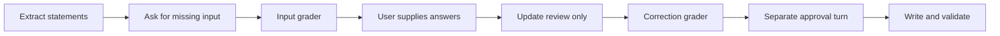

# Resolve missing human input

Test that answers resolve uncertain decisions without authorizing ledger writes.
Approval must arrive in a separate turn.

Import infers and saves statement groups in the first turn. Each active group/stage uses a separate subagent. A blocked account does not require categorization until its mapping is resolved. Saved groups remain stable across correction and approval.

Each intermediate grader must award `1` before the next turn starts.

## Setup

- Working directory: `/app/ledger`.
- Uses the `import-two-statements` Docker target and the current local plugin.
- The adapter resumes the same Codex session across all three steps.
- Native setup scripts identify each step before the agent runs.
- Limits: 1,200 seconds for the agent; 120 seconds for verification.
- See the [shared setup and run commands](../../README.md#run).

## Fixture

The task uses the [same CSV, PDF, ledger, and amounts](../import-two-statements/README.md#fixture)
as the normal import task. Only the user-supplied decisions differ.

| Decision | First turn | Correction turn |
| --- | --- | --- |
| Checking mapping | `Assets:Checking` is confirmed | Keep it |
| Savings ownership | The account belongs to the user | Keep it |
| Savings mapping | Uncertain; ask the user | Use `Assets:Savings` |
| Example Market category | Unknown; ask the user | Use `Expenses:Food` |
| Fees and interest | Categories are confirmed | Keep them |
| `XFER-001` | One own-account transfer | Resolve it once, with both source identities |

Expected closing balances remain 870 EUR checking and 602 EUR savings.
No financial files may change during the first two steps.

## Steps and grader

All steps use the [shared grader](../../verify.py) in a separate container.

### 1. Needs input

[Instruction](steps/needs-input/instruction.md) · [Grader entry point](steps/needs-input/tests/test.sh)

The `needs-input` grader checks:

- Both original sources are extracted into valid parsed documents.
- One import session contains both statements.
- Source hashes, row dates, amounts, and currencies match the fixture.
- The savings account mapping has `state: needs_input` and suggestions.
- The `C-001` category has `state: needs_input`, `disposition: hold`, and suggestions.
- No approval or written-stage validation is present. A current failed
  review-stage report may record unresolved choices; it cannot claim checked writes.
- Financial files and reusable memory remain unchanged.
- The response includes `Import Status: Needs Your Input` and a next step.

### 2. Correct

[Instruction](steps/correct/instruction.md) · [Grader entry point](steps/correct/tests/test.sh)

The user supplies the two missing answers. This turn does not approve writes.

The `correct` grader runs the full [review checks](../import-two-statements/README.md#1-review).
It also checks:

- Both affected inline decisions are `confirmed`.
- Each decision retains the exact human `answer`.
- The savings mapping is `Assets:Savings`.
- The market posting uses `Expenses:Food`.
- No approval field was added.

Both statements must reach `final_review`. The response must end with
`Import Status: Ready For Review`. The adapter saves the corrected review as
the checkpoint for the next turn.

### 3. Approve

[Instruction](steps/approve/instruction.md) · [Grader entry point](steps/approve/tests/test.sh)

The user now approves the corrected review. The standard
[approval checks](../import-two-statements/README.md#2-approve) apply:

- Write four new transactions and preserve both transfer references.
- Validate current ledger balances and source coverage.
- Record the EUR-only price result and eligible governed memory.
- Finish the group as `done` after both source sections pass written validation with `Import Status: Complete`.

Every phase preserves raw evidence, protected files, and Git history.
No phase may commit or push.

## Results and source map

- [task.toml](task.toml) averages step rewards and gates both earlier steps on `state = 1`.
- Trace failures reduce the step reward but do not block progression after passed state checks.
- Each verifier writes `reward.txt`, separate scores in `reward.json`, `report.json`, and a read-only review HTML file.
- See [shared result paths and limits](../../README.md#inspect-results).
- [Oracle solution](solution/solve.sh) and [reference helper](solution/correction_reference.py)
  cover the same three phases for explicit control runs.

## Agent trace checks

The full reward also requires the [trace grader](../../trace.py) to pass in each step.

| Step | Skills that must have been read | Commands required in this turn |
| --- | --- | --- |
| Needs input | Import, Process, Query, Categorize | Extraction preparation; Docling for both sources; `bean-query`; `git status` |
| Correct | Import, Query, Categorize | `bean-query`; `validate --session <id> --stage review`; `git status` |
| Approve | Import, Write, Query, Prices, Memory | `validate --session <id> --stage written`; `git status` |

- Read common guidance, the import contract, and parsed, session, and status schemas.
- Approval also requires the memory schema.
- Check freshness at initial inspection, resumed correction, and before writing
  or learning. Include the root ledger, import status, workspace marker,
  workspace `MEMORY.md`, and account directives. Correct and approve also need
  both parsed source sections. Approval also needs account and category memory.
- Reuse unchanged inspected content and known agent edits. Auto Bean change
  receipts identify tool changes. Refresh external or unreported changes.
  A new conversation turn alone does not require another read.
- Unresolved input does not require successful review validation.
- Correct does not require re-extraction. Approval does not require a price fetch.

Skill and reference reads can carry over within the same session. Required
workflow commands must run in their phase. Use the plugin launcher or documented
`auto_bean` helper for runtime commands.

See [trace rules and supported command forms](../../README.md#agent-trace-checks).
Each step writes `trace-report.json` with evidence locations and missing checks.
Full reward requires both state and trace checks. Oracle controls test state only.
