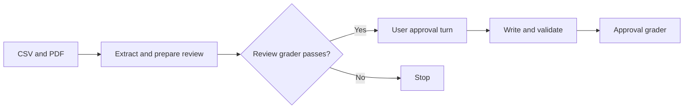

# Import two statements

Test a complete import with a separate review and approval turn.
Five source rows must produce four new ledger transactions.

## Setup

- Working directory: `/app/ledger`.
- Docker target: `import-two-statements` in the [shared Dockerfile](../../environment/Dockerfile).
- The fixture is built independently of the `init-ledger` task.
- The installed plugin must extract the original CSV and PDF.
- No parsed statements or expected answers are supplied to the agent.
- The adapter resumes the same Codex session for approval.
- Limits: 1,200 seconds for review; 600 seconds for approval; 120 seconds for verification.
- See the [shared setup and run commands](../../README.md#run).

## Fixture

[fixtures.py](../../fixtures.py) creates synthetic January 2026 statements for
Alex Example. All amounts are EUR. The workspace has one initial Git commit,
existing accounts, opening balances, and an unrelated `personal-notes.txt` file.

| Source | Account | Opening balance | Closing balance |
| --- | --- | ---: | ---: |
| `statements/raw/checking.csv` | `Assets:Checking` | 1,000 EUR | 870 EUR |
| `statements/raw/savings.pdf` | `Assets:Savings` | 500 EUR | 602 EUR |

| Date | Source reference | Event | Amount | Category or destination |
| --- | --- | --- | ---: | --- |
| January 5 | `C-001` | Example Market | −25 EUR | `Expenses:Food` |
| January 10 | `XFER-001`, checking | Own-account transfer out | −100 EUR | `Assets:Savings` |
| January 10 | `XFER-001`, savings | Same transfer in | +100 EUR | `Assets:Checking` |
| January 15 | `C-003` | Monthly bank fee | −5 EUR | `Expenses:Bank-Fees` |
| January 31 | `S-002` | Savings interest | +2 EUR | `Income:Interest` |

- `CHECKING-TEST` and `SAVINGS-TEST` ownership and mappings are confirmed.
- The existing opening transaction is dated December 31, 2025.
- Statement opening balances apply at the start of January 1.
- Closing balances apply at the end of January 31.
- Checking owns the shared transfer posting. Both source rows retain reciprocal links.
- No new accounts, opening balances, or external prices are needed.

## Steps and grader

Each step calls the [shared grader](../../verify.py) in a separate container.
The review step must earn `1` before Harbor supplies the approval turn.
The task uses the final step's reward.

### 1. Review

[Instruction](steps/review/instruction.md) · [Grader entry point](steps/review/tests/test.sh)

The agent prepares inline account mappings and transaction postings. It presents
both statements for review. It has no permission to write financial files yet.

The `review` grader checks:

- Both statements are at `final_review` in one import session.
- Parsed schemas, source hashes, dates, amounts, and descriptions are correct.
- Extraction evidence is complete and names Docling.
- Every row has a resolved decision and the expected postings.
- The transfer has one posting owner and valid reciprocal source links.
- Canonical financial files still match the initial fixture.
- The captured review matches the current material decisions.
- Reviewed postings produce the expected economics in a verifier-owned temporary ledger.
- No reusable memory was learned before approval.
- The response ends with `Import Status: Ready For Review` and a next step.

The adapter saves an immutable review checkpoint outside the agent workspace.
It contains the reviewed documents, material digests, and initial financial files.
A digest is a hash of the decision data that approval covers.

### 2. Approve

[Instruction](steps/approve/instruction.md) · [Grader entry point](steps/approve/tests/test.sh)

The user turn approves the preceding review. The agent must first check that
its source facts and decisions still match that review.

The `approve` grader checks the shared source and decision rules again. It also checks:

- Both statements are `done`.
- The ledger contains four new transactions, with the transfer posted once.
- Source provenance, existing entries, and closing balances are correct.
- Successful `written` validation covers the current decisions and ledger hashes.
- The price stage records a successful EUR-only result with zero jobs.
- Eligible account and merchant memory is saved after validated writes.
- Memory audit records retain source, review digest, and validation provenance.
- `.auto-bean/memory/MEMORY.md` is unchanged. No global preferences were requested.
- The response ends with `Import Status: Complete` and a next step.

Both steps preserve raw evidence, protected files, and Git history. Neither may
commit or push. Approval comes from the harness turn and saved checkpoint;
an agent-authored panel approval field is rejected.

## Results and source map

- Each step writes binary `reward.txt` and diagnostic `report.json`.
- Import phases export read-only `review.html` for inspection.
- See [shared result paths and limits](../../README.md#inspect-results).
- [Task configuration](task.toml) defines step order, reward gates, and artifacts.
- [Oracle solution](solution/solve.sh) provides the explicit control-run reference.
