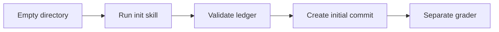

# Initialize a ledger

Test that the installed plugin can create a valid, empty EUR ledger.

## Setup

- Working directory: `/app/ledger`. It starts empty.
- Docker target: `init-ledger` in the [shared Dockerfile](../../environment/Dockerfile).
- The image provides uv, Git, and a synthetic Git identity.
- The adapter installs the current local plugin through a container marketplace.
- Dependency preparation uses a disposable directory. It does not initialize this ledger.
- Limits: 600 seconds for the agent; 120 seconds for the verifier.
- See the [shared setup and run commands](../../README.md#run).

## Fixture

This task has no input statements or opening balances in the workspace.
The expected output comes from the plugin's workspace template.

- Operating currency: `EUR`.
- Default accounts: `Assets:Checking` and `Equity:Opening-Balances`.
- Workspace marker: `.auto-bean/workspace.json`, format version `1`.
- Ledger files, statement directories, and governed memory must exist.
- Product skills and helpers stay outside the workspace.

The [instruction](instruction.md) requests the init skill, validation, and one
local commit. It prohibits invented transactions and a push. The final response
must report the destination, validation result, and next steps.

## Grader

[tests/test.sh](tests/test.sh) calls `verify.py init` in a separate container.
The [grader](../../verify.py) checks:

- The ledger loads without errors and uses EUR.
- The two default accounts are the only open accounts.
- There are no transactions, including opening-balance transactions.
- All template files and required directories exist.
- Governed memory JSON passes schema validation.
- Git has exactly one commit and a clean working tree.
- The ledger, workspace marker, and memory guide are tracked.
- No product skills, runtime caches, or virtual environments are tracked.
- No `.agents`, `.codex`, `scripts`, or `.venv` directory was copied in.
- Captured runtime validation succeeds.

The reward is `1` only if all checks pass. Otherwise, it is `0`.
The verifier writes `reward.txt`, separate scores in `reward.json`, and `report.json`. This task has no import
review HTML export. The final response guidance is part of the instruction;
the init grader checks workspace and runtime evidence.

## Source map

- [Task limits and artifacts](task.toml)
- [Agent environment](environment/docker-compose.yaml)
- [Verifier environment](tests/docker-compose.yaml)
- [Oracle solution](solution/solve.sh) — used only for explicit control runs

## Agent trace checks

The full reward also requires the [trace grader](../../trace.py) to pass.

- Read the installed `auto-bean-init/SKILL.md` and `references/common.md`.
- Read the resulting `ledger.beancount` and `.auto-bean/workspace.json`.
- Run the plugin launcher `init --workspace /app/ledger` successfully.
- Run `git status` in the ledger workspace.

The launcher performs validation and the initial commit. No separate `git commit`
command is required. Skill mentions in the final answer do not count as use.

The verifier writes `trace-report.json` with matching event locations and missing
requirements. See [trace rules and supported command forms](../../README.md#agent-trace-checks).
Full reward requires both state and trace checks. Explicit oracle controls use
the separate state-only policy.
