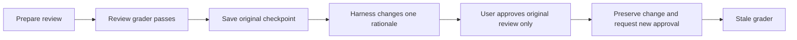

# Reject a stale review approval

Test that approval cannot authorize a decision that changed after review.
Success means renewed review with no ledger writes.

The user keeps both statements in one explicit group named January accounts. The saved group must remain unchanged in the stale-review turn. Processing and categorization require separate group subagents.

## Setup

- Working directory: `/app/ledger`.
- Uses the `import-two-statements` Docker target and the current local plugin.
- Review and stale-approval turns run in the same resumed Codex session.
- Limits: 1,200 seconds for the agent; 120 seconds for verification.
- The first step must earn `1` before the stale step starts.
- See the [shared setup and run commands](../../README.md#run).

## Fixture

The task uses the [same CSV, PDF, ledger, and confirmed decisions](../import-two-statements/README.md#fixture)
as the normal import task. All account mappings and categories are known.

Before the second turn, the [setup script](steps/stale/workdir/setup.sh) changes
one field in the checking source section of the group JSON:

- Record: `C-001`, the Example Market purchase.
- Field: `review.rationale`.
- New text: `Updated merchant interpretation requires renewed review.`

The amounts and postings do not change. The rationale is part of the material
review digest, so the original approval is stale. The saved checkpoint remains
outside the agent workspace and must not be replaced.

## Steps and grader

Both steps use the [shared grader](../../verify.py) in a separate container.

### 1. Review

[Instruction](steps/review/instruction.md) · [Grader entry point](steps/review/tests/test.sh)

The standard [review checks](../import-two-statements/README.md#1-review) apply:

- Extract both sources and resolve all five rows.
- Prepare four economic transactions, including one shared transfer.
- Leave both statements at `final_review`.
- Preserve the initial financial files and reusable memory.
- End with `Import Status: Ready For Review`.

The adapter saves the reviewed documents, material digests, and financial baseline.

### 2. Stale approval

[Instruction](steps/stale/instruction.md) · [Grader entry point](steps/stale/tests/test.sh)

The user approves only the preceding, unchanged review. The agent must detect
the changed rationale, preserve it, and request renewed approval.

The `stale` grader checks:

- Both sources remain in one valid session with complete extracted evidence.
- Source hashes, row dates, amounts, and currencies match the fixture.
- The original checkpoint still contains the initial financial baseline.
- Checking matches the original material review plus the exact rationale change.
- Checking's digest differs from the original reviewed digest.
- Savings still matches its original reviewed digest.
- Neither parsed document has approval or written-stage validation. Any retained
  review-stage validation must describe the current candidate, not the old review.
- Both statements remain at `final_review`.
- Financial files and reusable memory remain unchanged.
- The response includes `Import Status: Ready For Review` and a next step.

The grader checks structured state and the status block. It does not use a
language model to judge the wording of the refusal. Reverting the rationale,
changing other material decisions, or writing transactions fails this contract.
No phase may commit or push.

## Results and source map

- [task.toml](task.toml) averages step rewards and gates the stale turn on `state = 1`.
- Trace failures reduce the step reward but do not block progression after passed state checks.
- Each verifier writes `reward.txt`, separate scores in `reward.json`, `report.json`, and a read-only review HTML file.
- See [shared result paths and limits](../../README.md#inspect-results).
- [Oracle solution](solution/solve.sh) and [reference helper](solution/stale_reference.py)
  cover the same stale-decision case for explicit control runs.

## Agent trace checks

The full reward also requires the [trace grader](../../trace.py) to pass in both steps.

| Step | Skills that must have been read | Commands required in this turn |
| --- | --- | --- |
| Review | Import, Process, Query, Categorize | Extraction preparation; Docling for both sources; `bean-query`; review validation; `git status` |
| Stale | Import | `git status` and refreshed evidence for the changed group JSON |

- Read common guidance, the import contract, and parsed, session, and status schemas.
- Check freshness at initial inspection and resumed review. Include the root
  ledger, import status, workspace marker, workspace `MEMORY.md`, account
  directives, and both parsed source sections.
- Reuse unchanged inspected content and known agent edits. Auto Bean change
  receipts identify tool changes. A new turn alone does not require another read.
- The harness changes the parsed group JSON outside the agent. Refresh evidence
  for that file before deciding whether to write. Earlier content that no longer
  matches cannot satisfy this check. Unchanged files can carry over.
- The stale turn does not require Write, re-extraction, price fetching, or written validation.
- State checks still prove that the changed rationale is preserved and financial
  files are unchanged.

Skill and reference reads can carry over from the review turn. Runtime commands
must use the plugin launcher or documented `auto_bean` helper.

See [trace rules and supported command forms](../../README.md#agent-trace-checks).
Each step writes `trace-report.json` with evidence locations and missing checks.
Explicit oracle controls test state only; they do not establish plugin use.
