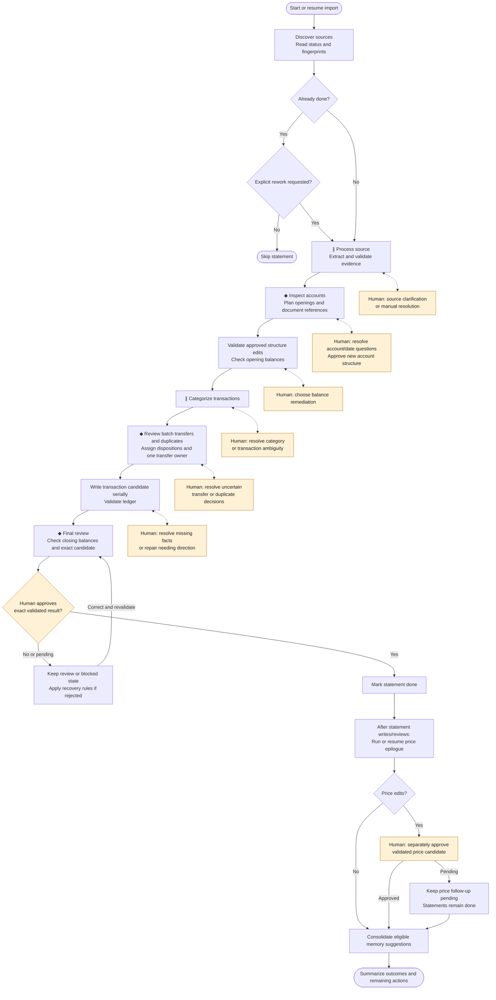

# Import process flow

This diagram summarizes [auto-bean-import](../skills/auto-bean-import/SKILL.md). Orange nodes show human involvement; dotted branches are conditional clarification loops.

- **∥** marks processing or categorization that may use parallel statement-scoped workers.
- **◆** marks potential coordination bottlenecks owned by the main import agent, rather than measured runtime delays.

Each statement resumes from its persisted status and advances when ready. Independent safe work continues while questions are pending; unresolved cross-statement transfer or duplicate evidence holds the affected posting cohort. All ledger writes, including accounts, documents, and prices, remain serialized. Import alone updates shared status and brokers worker questions.

Transaction candidates are written and validated before final statement approval. Acceptance requires explicit approval of the exact candidate after its hashes and validation are rechecked. Rejected candidates follow the recovery rules and return to the owning blocked stage; the correction arrow summarizes that recovery, which may revisit an earlier stage.

The price epilogue runs once after statement writes and current review decisions, including when some statements remain pending. It skips fetching only when there are no new writes and no pending price follow-ups. A statement can remain `done` while price approval is pending; the overall import is `Complete` only when all in-scope statements are `done` and no follow-up or price approval remains.

For detailed transitions and recovery, see [status handling](import-status-reading.md), [workflow rules](workflow-rules.md), and [candidate review](candidate-review.md).
