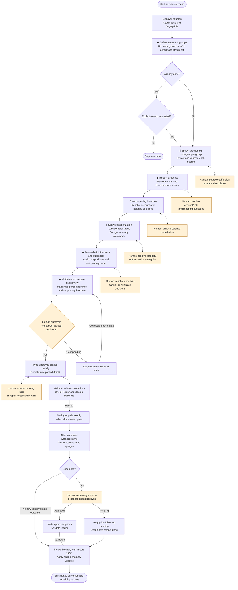

# Import data reference

Use this reference for field meanings and edge cases. The Import, Process, Categorize and Write skills own the workflow; [common guidance](common.md#ownership) owns editing boundaries and [the validation command](common.md#validation).

## Process flow

This is the canonical process diagram for [Import](../skills/auto-bean-import/SKILL.md). Each session has user-defined or agent-inferred statement groups, usually one statement per group. Import spawns a separate subagent for each group's processing and categorization stages when needed. **∥** marks work that can run in parallel across independent groups. **◆** marks coordination owned by the main import agent, not a measured runtime delay. Orange nodes show human input; dotted links are conditional clarification loops.

Each group resumes from its saved status and source sections; the diagram shows the full path for a new import. Independent safe work continues while questions are pending. Unresolved transfers or duplicates hold the affected group of rows. Edits to the same parsed document and all ledger writes are serialized under the [ownership rules](common.md#ownership).

Before first approval, proposed postings and supporting directives remain in parsed JSON and the ledger is unchanged. The statement review covers mappings, openings and transactions together; clarification loops are conditional, not extra approval rounds. A shared transfer requires approval for all affected statements. Write returns its written validation result to Import for `done`; failures return to the owning stage for repair. Material corrections require renewed review. Interrupted writes resume from actual provenance without duplicate appends or whole-file restoration.

The price epilogue runs after the current statement pass, including when some work remains pending. It records a zero-job result when no commodities need prices. Price questions or approval can remain pending while groups stay `done`. Memory uses only accepted, verified work; unresolved proposals are not learned. The overall import is `Complete` only when every in-scope group is done and no price or follow-up action remains.

## State and validation

There are three authoritative import surfaces:

- `statements/import-status.yml` ([status schema](schemas/status.schema.json)): one `groups.<group_id>` entry with `session_id`, `parsed_group`, `current_status` and group input/repair flags. Its `sources` map holds raw-path fingerprints and retry information, never source lifecycle statuses.
- One parsed JSON per group ([group schema](schemas/parsed-group.schema.json)): `group_id` and a `statements` list. Each source section follows the embedded [statement schema](schemas/parsed-v2.schema.json), with source identity, extraction facts, inline decisions and generated validation. All member sections share this one physical file.
- `.auto-bean/import-sessions/<session-id>.json` ([session schema](schemas/session.schema.json)): groups and price runs. It does not contain a second statement or transaction list.

Each session group has a stable workspace-unique `group_id`, `name`, `origin` (`user` or `agent`), nonempty `source_files` and one `parsed_group` path. A source belongs to exactly one group. Distinct groups cannot share a parsed path. Session, YAML and parsed JSON must agree on group identity and exact source membership. An empty session has no groups.

Keep a group's lifecycle at its earliest unresolved stage. Input and repair flags summarize all its members. Ready members may make safe progress while another is blocked, but serialize every edit to the shared JSON. Import may explicitly dispatch categorization for ready sections; it cannot advance the whole group until all members are ready. Preserve completed member sections on retry. `final_review` and `write_blocked` cover interrupted or partial writes. Only current passed written validation for every member permits group `done`. Per-source reports and approvals remain inside the group file; they are not separate lifecycle entries.

Pending/running/failed extraction requires source identity/fingerprint, source format, extraction state, account/record arrays and `review.processing`. Arrays may be empty; parser metadata and completion time are required only for complete extraction. Partial evidence never enters accounting stages.

Account names and reported balances are source facts; `statement_metadata.accounts[].review` holds ledger mapping, rationale, required `proposed_directives` and queried reconciliation. Transaction amount/date/description remain source facts; `extracted_records[].review` holds explicit postings, disposition, rationale and links. Amounts are decimal strings. Missing information is absent or explicitly unavailable, never invented or zero-filled.

IDs identify stable source rows/accounts, not parser runs. Preserve `source_reference` and IDs during reparse. Put arbitrary source-column values only in `raw_fields`. Use `state: needs_input`, rationale and optional suggestions beside the affected decision; extraction input uses `review.processing.needs_input`. An `answer` preserves the user's response until the owning stage checks and resolves it.

`review.validation` and each price run's `validation` are generated. Their `stage` distinguishes review readiness from written-ledger checks; a passed review-stage report is insufficient for `done`. Their timestamps, digests and ledger hashes identify what was checked. Direct file edits can make a saved result stale; rerun validation. Agents leave these generated fields alone.

Optional `approval` fields belong to panel bookkeeping. Chat approval needs no JSON counterpart: retain the explicit instruction in the conversation. A stored panel confirmation only applies to the data the user saw. Neither an approval-shaped object nor a validation report establishes permission by itself.

## Transaction dispositions

| Disposition | Required meaning |
| --- | --- |
| `post` | Write one economic transaction from the explicit postings. |
| `existing_duplicate` | `existing_transaction` identifies an already accepted canonical transaction by workspace-relative path and one-based line; verify its date, postings, source-account movement and payee when available. Existing narration may differ. |
| `paired_transfer` | Reciprocal `linked_records` identify source path, account ID and row ID. `posting_owner` identifies the source that supplies the single economic posting. |
| `hold` | Intent or accounting input remains unresolved; do not write it. |

A shared transfer preserves both identities in ledger metadata: `source`, `source_fingerprint`, `account_id`, `record_id` and the corresponding `peer_` fields. It covers exactly the two linked rows. Within one source, the lexicographically first linked row ID supplies the posting; its counterpart may leave postings empty. New ledger narration and any extracted payee come from that owner's source row. Ordinary posted rows preserve their own source description/payee.

Required account openings, source-supported opening transactions, document directives and justified balance assertions belong in account `proposed_directives` before review. Document paths are workspace-relative in this field; Write adjusts relative paths for the actual target ledger file. The validator checks those approved directives in the include graph. An unexplained balance difference never authorizes an opening adjustment.

## Status

| Status | Meaning |
| --- | --- |
| `raw_ready` | Ready for Process. |
| `process_blocked` / `process_review` | Missing evidence or processing input/warnings to resolve. |
| `account_review` / `account_blocked` | Mapping and supporting account decisions. |
| `balance_review` / `balance_blocked` | Opening evidence and existing-ledger reconciliation. |
| `categorize_ready` / `categorize_blocked` / `categorize_review` | Categorization and shared-row resolution. |
| `write_ready` / `write_blocked` | Complete decisions ready for final review, or a write/validation repair. |
| `final_review` | Awaiting approval, writing or validation. First review leaves the ledger unchanged; an interrupted approved write may already contain entries. |
| `done` | The actual ledger passed written-stage checks; reopening requires explicit rework. |

Retry counts belong to the source fingerprint. Newly added optional fields do not require rewriting completed imports.

## Reading evidence

Inspect source identity, extraction state, account IDs and record count before reading bounded rows. Filter by account, row ID, date, description or amount/currency. Keep source/account/record IDs in clarification excerpts. Python or optional jq can inspect JSON; no special reader API is required. The panel pages at most 100 transaction rows at a time.

## Examples

The [group parsed example](parsed-statement-output.example.json) shows two accounts and six rows, including a split, refund, answered question and reciprocal transfer. The [session example](import-session.example.json) contains group membership, its parsed path and a synthetic price run. The [status example](import-status.example.yml) tracks that group.

These illustrate structure, not instructions or approval. Never copy generated confirmations, hashes or successful results into a real import. The panel and validator produce their own evidence from the selected workspace.
