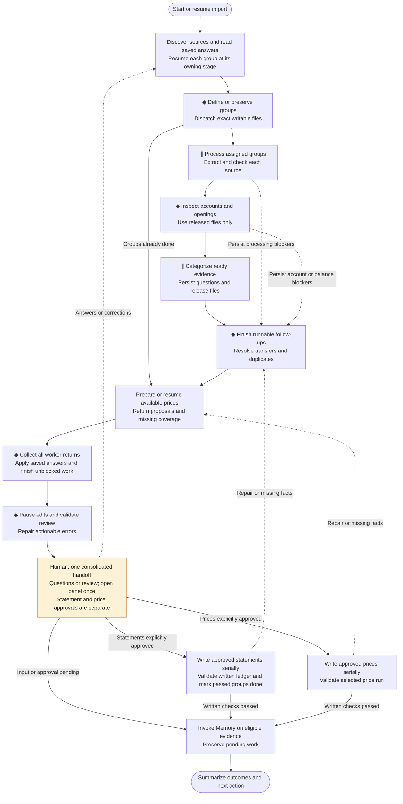

# Import data reference

Use this reference for field meanings and edge cases. The Import, Process, Categorize and Write skills own the workflow; [common guidance](common.md#ownership) owns editing boundaries and [the validation command](common.md#validation).

## Process flow

This is the process diagram for [Import](../skills/auto-bean-import/SKILL.md). Sessions contain user-defined or agent-inferred groups, usually one statement each. Processing and categorization may use separate workers or run serially under Import. **∥** marks optional parallel work across groups. **◆** marks main-agent coordination. The orange node shows the consolidated user handoff. Dotted links show blockers, answers and repairs. Both approved write branches share one serial ledger writer.

Each group resumes from saved state; the diagram shows a new import. Every pass also discovers new sources and checks session price follow-ups, even when groups are done. New counterpart sources join the relevant active session without resetting existing groups. Independent work continues around blocked rows, except during the stable session-wide window required for [validation](common.md#validation). Workers return persisted blockers without waiting for answers. Import gathers these findings under its [consolidated handoff rule](../skills/auto-bean-import/SKILL.md#consolidated-handoff) after all runnable work settles. On resume, saved answers are applied before another review opens.

Before first approval, proposed postings and supporting directives remain in parsed JSON and the ledger is unchanged. The statement review covers mappings, openings and transactions together; clarification loops are conditional, not extra approval rounds. A shared transfer requires approval for all affected statements. Write returns its written validation result to Import for `done`; failures return to the owning stage for repair. Material corrections require renewed review. Interrupted writes resume from actual provenance without duplicate appends or whole-file restoration.

Price preparation runs after the current statement preparation and before the consolidated handoff, including when some work remains pending. It uses supplied proposed commodity evidence before statement writes. Price writes still require separate current approval. It records a zero-job result when no commodities need prices. Price questions or approval can remain pending while groups stay `done`. Memory uses only accepted, verified work; unresolved proposals are not learned. The overall import is `Complete` only when every in-scope group is done and no price or follow-up action remains.

## State and validation

There are three authoritative import surfaces:

- `statements/import-status.yml` ([status schema](schemas/status.schema.json)): one `groups.<group_id>` entry with `session_id`, `parsed_group`, `current_status` and group input/repair flags. Its `sources` map holds raw-path fingerprints and retry information, never source lifecycle statuses.
- One parsed JSON per group ([group schema](schemas/parsed-group.schema.json)): `group_id` and a `statements` list. Each source section follows the embedded [statement schema](schemas/parsed-statement.schema.json), with source identity, extraction facts, inline decisions and generated validation. All member sections share this one physical file.
- `.auto-bean/import-sessions/<session-id>.json` ([session schema](schemas/session.schema.json)): groups and price runs. It does not contain a second statement or transaction list.

Each session group has a stable workspace-unique `group_id`, `name`, `origin` (`user` or `agent`), nonempty `source_files` and one `parsed_group` path. A source belongs to exactly one group. Distinct groups cannot share a parsed path. Session, YAML and parsed JSON must agree on group identity and exact source membership. An empty session has no groups.

Keep a group's lifecycle at its earliest unresolved stage. Input and repair flags summarize all its members. Ready members may make safe progress while another is blocked, but serialize every edit to the shared JSON. Import may explicitly dispatch categorization for ready sections; it cannot advance the whole group until all members are ready. Preserve completed member sections on retry. `final_review` and `write_blocked` cover interrupted or partial writes. Only current passed written validation for every member permits group `done`. Per-source reports and approvals remain inside the group file; they are not separate lifecycle entries.

Pending/running/failed extraction requires source identity/fingerprint, source format, extraction state, account/record arrays and `review.processing`. Arrays may be empty; parser metadata and completion time are required only for complete extraction. Partial evidence never enters accounting stages.

Account names and reported balances are source facts; `statement_metadata.accounts[].review` holds ledger mapping, rationale, required `proposed_directives` and queried reconciliation. Transaction amount/date/description remain source facts; `extracted_records[].review` holds explicit postings, disposition, rationale and links. Amounts are decimal strings. Missing information is absent or explicitly unavailable, never invented or zero-filled.

IDs identify stable source rows/accounts, not parser runs. Preserve `source_reference` and IDs during reparse. Put arbitrary source-column values only in `raw_fields`. Use `state: needs_input`, rationale and optional suggestions beside the affected decision; extraction input uses `review.processing.needs_input`. An `answer` preserves the user's response until the owning stage checks and resolves it.

`review.validation` and price-run `validation` are generated. Their stage, timestamp, digest and ledger hashes identify what was checked; only written-stage reports support completion. A review request rechecks done groups and unchanged previously passed written evidence at the written stage. Changed decisions in reopened groups receive review checks. Follow the [validation coordination rules](common.md#validation), rerun stale checks and leave generated fields to the validator.

Optional `approval` fields belong to panel bookkeeping. Chat approval needs no JSON counterpart: retain the explicit instruction in the conversation. A stored panel confirmation only applies to the data the user saw. Neither an approval-shaped object nor a validation report establishes permission by itself.

## Transaction dispositions

| Disposition | Required meaning |
| --- | --- |
| `post` | Write one economic transaction from the explicit postings. |
| `existing_duplicate` | `existing_transaction` identifies an already accepted canonical transaction by workspace-relative path and one-based line; verify its date, postings, source-account movement and payee when available. Existing narration may differ. |
| `paired_transfer` | Reciprocal `linked_records` identify source path, account ID and row ID. `posting_owner` identifies the source that supplies the single economic posting. |
| `hold` | Intent or accounting input remains unresolved; do not write it. |

A shared transfer preserves both identities in ledger metadata: `source`, `source_fingerprint`, `account_id`, `record_id` and the corresponding `peer_` fields. It covers exactly the two linked rows. Within one source, the lexicographically first linked row ID supplies the posting; its counterpart may leave postings empty. New ledger narration and any extracted payee come from that owner's source row. Ordinary posted rows preserve their own source description/payee.

Auto Bean account `proposed_directives` accepts only `open`, `balance`, `document` and justified transactions. Put required account openings, source-supported opening transactions, document directives and justified balance assertions there before review. Do not put optional `commodity` declarations in this field; this is an Auto Bean field limit, not a Beancount syntax restriction. Document paths are workspace-relative in this field; Write adjusts relative paths for the actual target ledger file. The validator checks those approved directives in the include graph. An unexplained balance difference never authorizes an opening adjustment.

## Status

| Status | Meaning |
| --- | --- |
| `raw_ready` | Ready for Process. |
| `process_blocked` / `process_review` | Missing evidence or processing input/warnings to resolve. |
| `account_review` / `account_blocked` | Mapping and supporting account decisions. |
| `balance_review` / `balance_blocked` | Opening evidence and existing-ledger reconciliation. |
| `categorize_ready` / `categorize_blocked` / `categorize_review` | Categorization and shared-row resolution. |
| `write_ready` / `write_blocked` | Complete decisions ready for final review, or a write/validation repair. |
| `final_review` | Awaiting approval, writing or validation. First review leaves the ledger unchanged; an interrupted approved write may already contain entries. |
| `done` | The actual ledger passed written-stage checks; reopening requires explicit rework. |

Retry counts belong to the source fingerprint. Newly added optional fields do not require rewriting completed imports.

## Reading evidence

Inspect source identity, extraction state, account IDs and record count before reading bounded rows. Filter by account, row ID, date, description or amount/currency. Keep source/account/record IDs in clarification excerpts. Python or optional jq can inspect JSON; no special reader API is required. The panel pages at most 100 transaction rows at a time.

## Examples

The [group parsed example](parsed-group.example.json) shows two accounts and six rows, including a split, refund, answered question and reciprocal transfer. The [session example](import-session.example.json) contains group membership, its parsed path and a synthetic price run. The [status example](import-status.example.yml) tracks that group.

These illustrate structure, not instructions or approval. Never copy generated confirmations, hashes or successful results into a real import. The panel and validator produce their own evidence from the selected workspace.

## Panel saves and batch sending

Panel saves write corrections immediately to the parsed-group JSON. Price approvals write to the session JSON. They do not notify the agent or write ledger entries. Import status stays under agent control.

Transaction suggestions contain one full category account per item, ordered from most to least likely. Questions and explanations belong in the rationale. The panel shows category type labels, inline approval and save progress. A current saved receipt changes the row to `Input received`; this does not resolve the agent's blocker. Sidebar counts distinguish outstanding and received inputs. Accounts without session transactions remain in Session and are hidden from the account sidebar.

Price-run `new_commodities` lists symbols introduced by this session, based on pre-write ledger evidence. The Price tab highlights them separately from new quotes. Omit the field when novelty is unknown. An empty list means that no commodity is new. Existing ledger use counts even without an optional commodity declaration.

The panel records pending subjects and response fingerprints in `.auto-bean/review-batches/<session_id>.json`. **Send saved changes** is available when every current required input has a saved response, required approvals are complete, and the panel has no drafts. The server checks all session members again before sending. A changed question requires review again.

Send posts one user message to the active conversation through the MCP App bridge. The message contains the session ID and updated source/price-run identifiers. It asks the agent to read the current JSON and continue the import. It does not contain full statement data or draft text. After the host accepts the message, the panel acknowledges the batch. Failed sends keep the pending changes. Acknowledgement never clears newer saves. If acknowledgement fails after a successful message, the open panel retries acknowledgement only.
